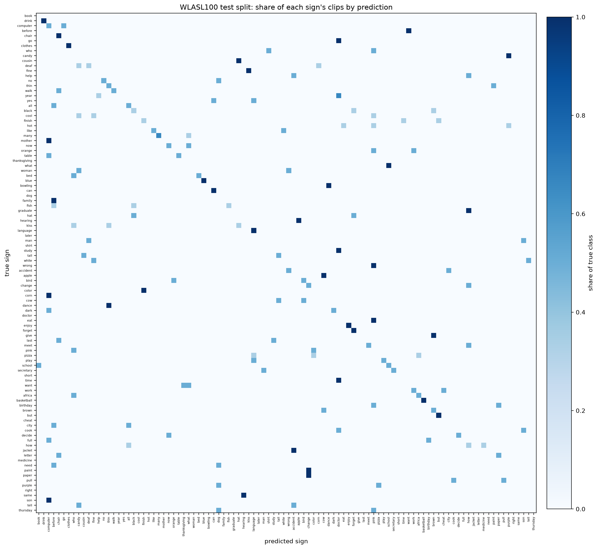

# signlang

Real-time recognition of isolated American Sign Language words from a webcam. MediaPipe extracts
hand and body landmarks, a two-layer GRU classifies the last couple of seconds of motion, and the
predicted word is drawn live on screen. Trained on [WLASL100](https://dxli94.github.io/WLASL/) (the
100 most common signs). Meant for researchers and students who want a small, reproducible
sign-recognition baseline that trains on a laptop CPU.

> **Status:** the full pipeline (download, landmark extraction, training, evaluation, live demo) is
> implemented, unit-tested and has been run end to end. Accuracy on the dataset's test split is
> measured; accuracy with real people at a webcam is **not measured yet** (see below).

## Results

WLASL100, official test split: **159 clips** (see "What the numbers are based on"). Brackets are
95% bootstrap confidence intervals; with this few clips a single figure is only known to about
±7 points.

| Model | Top-1 | Top-5 |
| ----- | ----- | ----- |
| Baseline: mean landmarks + logistic regression | 17.6% [11.9, 23.3] | 43.4% [35.8, 50.9] |
| Two-layer GRU, best-validation seed | **26.4%** [19.5, 33.3] | **52.2%** [44.0, 59.7] |
| Two-layer GRU, mean ± std over 5 seeds | 24.4% ± 2.3% | 47.5% ± 3.0% |

The GRU beats the baseline by 8.8 points top-1 (paired bootstrap 95% interval +1.9 to +16.4), so
the gain from modelling motion is real, but the interval is wide.

| Speed | Value |
| ----- | ----- |
| Full pipeline (MediaPipe + GRU) on a video file, 8-core CPU, no display | about 30 FPS, 30 ms per frame |
| Live webcam FPS | **TBD**, run `signlang demo` and read the line printed on exit |
| Accuracy with real people, lighting and backgrounds | **TBD**, protocol in [docs/live_testing.md](docs/live_testing.md) |



### What the numbers are based on

- **Only half of WLASL100 could be downloaded.** 1,021 of 2,038 videos (50.1%) were still
  reachable: 681/1,442 train, 179/338 val, 161/258 test. 14 more had no detectable shoulders, so
  the models used **671 / 177 / 159** clips, about 7 training clips per sign. Dead links (403, 404,
  pages instead of videos), Flash clips from aslpro.com and an expired certificate account for the
  rest. Published WLASL100 results train on all 1,442 clips, so **these numbers are not comparable
  to published ones**, and a larger training set would very likely score higher.
- **Test signers were seen in training.** 99% of test clips come from signers who also appear in
  the training split, which is how WLASL's official splits are built. Accuracy on new people will be
  lower.
- **Validation looked better than test** (GRU about 37% against 24–26%; the tuned baseline 30%
  against 18%). The validation split chose the hyperparameters and the checkpoint, and 177 clips is
  small, so its scores are optimistic. The test split was scored once, after every choice was
  fixed. How the configuration was chosen is in [docs/tuning.md](docs/tuning.md); the plain
  architecture from the brief, without regularization or mean pooling, scored about 20% on
  validation and lost to the baseline.
- **The confusion matrix is too sparse to read.** With 1 to 3 test clips per sign, each row has
  almost nothing in it. No claim about signs sharing a handshape or movement can be made from it.
  More data per sign is what it would take.

### Choosing the confidence threshold

The demo only shows a word when the top probability reaches a threshold. On the validation split,
for the selected model:

| Threshold | Clips that pass | Correct among those |
| --------: | --------------: | ------------------: |
| 0.30 | 59% | 50% |
| 0.40 | 42% | 57% |
| 0.50 | 31% | 65% |
| **0.60 (default)** | 20% | 69% |

A higher threshold shows fewer words but is right more often. `--threshold` changes it.

## How it works

```
webcam / video ──► MediaPipe pose + hands ──► 75 points × (x, y, z) per frame
                                                  │
              normalize: center on shoulders, scale by shoulder width
              missing hands → 0, resample the window to 32 frames
                                                  │
                                       2-layer GRU ──► 100 sign logits
                                                  │
                  confidence + stability gate ──► word on screen (+ FPS)
```

Design decisions that matter:

- **Normalization.** Every frame is centered on the shoulder midpoint and divided by shoulder width,
  so where you stand and how far you are from the camera do not matter.
- **Missing hands are masked after normalizing.** An undetected landmark is stored as NaN and becomes
  exact zeros once normalized. Feeding zeros into the formula would instead move the "missing" hand
  to `-center / width`, a plausible-looking but wrong position.
- **Mirror augmentation swaps hands and pose pairs.** Flipping x alone gives a signer whose left
  hand is on the right. `mirror` also swaps the two hand blocks and every left/right pose pair
  (shoulders, elbows, wrists, ...).
- **Pixel coordinates, not MediaPipe's normalized ones.** x and y are scaled by the frame size so
  rotation augmentation is a true rotation, not a shear on non-square frames.
- **Hands are labelled from the pose, not from MediaPipe's handedness flag.** Each detected hand is
  matched to the nearest pose wrist, which sidesteps the mirrored-selfie ambiguity of the classifier.
  The live demo extracts landmarks from the *unmirrored* frame and only flips the picture it shows.
- **Official WLASL splits** are used so numbers are comparable with published ones. They are not
  signer-independent; the evaluation reports how many test clips come from signers seen in training.
- **Window length is a time scale.** Training clips are whole signs resampled to 32 frames, so the
  live window (`--window`, default 64 frames) is resampled the same way. A 32-frame window at 30 FPS
  would show the model only half of a typical sign.
- **Model selection uses the validation split only.** The test split is read by `evaluate` and
  nowhere else. Five seeds are trained; the table reports the best-by-validation checkpoint and the
  mean ± std over all five.
- **The GRU averages its hidden state over time** instead of reading only the last frame's. On this
  small dataset that was the single biggest gain on validation (+5 to +6 points), together with
  augmentation that simulates missed hand detections and shifted timing.

## Quickstart

Requires [uv](https://docs.astral.sh/uv/), which installs the pinned Python and all dependencies.

```bash
git clone <this repo> && cd hand_signs_realtime_detection
make sync                     # uv sync --locked
make check                    # ruff + pyright + pytest, same as CI
```

Reproduce the results (about an hour on an 8-core laptop with no GPU: roughly 25 min of
downloading, 15 min of landmark extraction and 15 min of training):

```bash
uv run signlang fetch-meta    # WLASL index files (12 MB)
uv run signlang download      # videos -> data/raw, outcome of every link -> data/manifest.csv
uv run signlang extract       # MediaPipe landmarks -> data/landmarks/*.npy
uv run signlang prepare       # normalize + resample -> data/processed/*.npz
uv run signlang train --model baseline
uv run signlang train --model gru --seeds 5
uv run signlang evaluate      # TEST split -> reports/results.{json,md}, confusion matrix
uv run signlang demo          # webcam; press q to quit
```

`signlang demo --source clip.mp4 --headless` runs the same pipeline on a video file and prints the
words it recognizes. PyTorch is pinned to CPU wheels (see `pyproject.toml`); to use CUDA, drop the
`pytorch-cpu` index and source entries and re-lock.

## Project layout

```
src/signlang/
  constants.py     landmark layout, mirror permutation
  preprocess.py    normalize, resample
  augment.py       rotate, scale, mirror
  landmarks.py     MediaPipe extraction, hand assignment
  data/            WLASL metadata, downloader, batch extraction, dataset
  models/          logistic-regression baseline, SignGRU
  train.py         training loops (validation split only)
  evaluate.py      test-split metrics, confusion matrix, signer overlap
  metrics.py       top-k accuracy, bootstrap CI, most-confused pairs
  live.py          sliding window, prediction gate, webcam loop
  cli.py           `signlang` command
tests/             pytest suite
docs/              hyperparameter selection, live-testing protocol
data/, models/     downloads, cached landmarks, checkpoints (git-ignored)
reports/           results.json / results.md / figures
```

## Limitations

- Recognizes **isolated words** from a fixed vocabulary of 100 signs, not continuous signing or
  sentences. It can only say "nothing" through a confidence threshold, not "I don't know this sign".
- Only 1,021 of the 2,038 WLASL100 videos could be downloaded, so the model learns each sign from
  about 7 examples. Top-1 is 26% on the test split; expect it to be lower on new signers.
- WLASL's official splits share signers between train and test, so test accuracy partly rewards
  recognizing familiar signers. Live accuracy on new people should be expected to be lower.
- Landmarks carry no facial expression, mouth shapes or fine finger detail, all of which carry
  meaning in ASL.
- Not an accessibility product and not a substitute for an interpreter.

## Data and licensing

WLASL is distributed under the [Computational Use of Data Agreement (C-UDA 1.0)](https://github.com/microsoft/Computational-Use-of-Data-Agreement),
for computational research use. The videos belong to their original publishers, so this repository
does not redistribute them; `signlang download` fetches them from the original hosts.

Code is released under the [MIT License](LICENSE).
